# DOKUMEN PERANCANGAN SISTEM SIMASADI
## Bagian 4: Tahap Perancangan (Design)

---

### 4.1 Struktur Navigasi (Sitemap)

Struktur navigasi menggambarkan alur perpindahan antarmuka pengguna dalam mengakses seluruh menu dan fitur pada sistem SIMASADI. Sesuai dengan pembagian hak akses 2 peran nyata (Ketua Tim dan PIC Laboratorium), struktur navigasi dibagi menjadi:
1. **Navigasi Tingkat Utama Antarmuka**: Menggambarkan hubungan dari halaman Login, menuju Dashboard utama, hingga ke seluruh menu operasional tingkat satu yang saling terhubung secara horizontal (*bi-directional*).
2. **Struktur Navigasi Hierarki Sub-Halaman**: Menggambarkan pohon navigasi dari setiap menu utama hingga ke halaman formulir penambahan, pengubahan, import massal, dan halaman detail data.

#### 4.1.1 Struktur Navigasi Tingkat Utama (Ketua Tim & PIC)

[](diagrams/04-01-navigasi-utama.html "Buka diagram interaktif")

> *Gambar 4. 1: Struktur Navigasi Utama SIMASADI (Ketua Tim & PIC Laboratorium)* — [Buka Versi Interaktif HTML](diagrams/04-01-navigasi-utama.html)

---

#### 4.1.2 Struktur Navigasi Hierarki Sub-Halaman Lengkap

[](diagrams/04-02-navigasi-hierarki.html "Buka diagram interaktif")

> *Gambar 4. 2: Struktur Navigasi Hierarki Sub-Halaman SIMASADI* — [Buka Versi Interaktif HTML](diagrams/04-02-navigasi-hierarki.html)

---

### 4.2 Use Case Diagram

Diagram Use Case memodelkan fungsi-fungsi sistem dari sudut pandang 2 peran pengguna (*aktor*). Notasi yang digunakan merujuk pada standar UML (*Unified Modeling Language*):
* **Ketua Tim (Admin Unit Akreditasi)** (`admin`): Pengelola sistem dengan akses penuh terhadap seluruh fitur administrasi, master LPK, asesmen, rilis SK, dan manajemen pengguna.
* **PIC Laboratorium** (`pic`): Pendamping teknis operasional dengan fokus pada pengelolaan LPK binaan, pemantauan pengawasan, pelacakan tindakan perbaikan, dan agenda kalender.

[](diagrams/04-03-use-case-rbac.html "Buka diagram interaktif")

> *Gambar 4. 3: Use Case Diagram Sistem SIMASADI (2 Peran Pengguna)* — [Buka Versi Interaktif HTML](diagrams/04-03-use-case-rbac.html)

---

### 4.3 Activity Diagram

Aktivitas sistem dimodelkan menggunakan diagram aktivitas berbasis status dan transisi aktivitas UML (`stateDiagram-v2`), menyajikan secara runtut proses bisnis otentikasi peran pengguna internal (**Ketua Tim** dan **PIC Laboratorium**), penegakan siklus akreditasi KAN, hingga pemenuhan tindak lanjut perbaikan:

---

#### 4.3.1 Activity Diagram: Autentikasi Ketua Tim (Admin)

Diagram ini memodelkan alur aktivitas autentikasi akun Ketua Tim (Administrator Unit Akreditasi) sesuai implementasi controller autentikasi SIMASADI (`AuthController`), mulai dari perenderan form login, validasi input dan reCAPTCHA, verifikasi kredensial via `Auth::attempt`, hingga regenerasi sesi administratif:

[](diagrams/04-04-act-auth-ketua-tim.html "Buka diagram interaktif")

> *Gambar 4. 4: Activity Diagram Autentikasi Ketua Tim (Admin Unit Akreditasi)* — [Buka Versi Interaktif HTML](diagrams/04-04-act-auth-ketua-tim.html)

| No | Tahap / Status | Aktor Terkait | Keterangan Teknis Operasional |
|:---|:---|:---|:---|
| 1 | `BukaHalamanLogin` | Ketua Tim | Pengguna membuka peramban web dan mengakses rute URL `/login`. |
| 2 | `TampilFormLogin` | Sistem SIMASADI | Sistem merender tampilan formulir login dan widget keamanan Google reCAPTCHA. |
| 3 | `SubmitKredensial` | Ketua Tim | Pengguna memasukkan email dan password akun Ketua Tim (`admin@simasadi.local`). |
| 4 | `ValidasiFormat` | Sistem SIMASADI | Sistem memvalidasi kelengkapan data masukan dan respon reCAPTCHA via `AuthController::store`. |
| 5 | `CekValiditasKredensial` | Sistem SIMASADI | *Choice Node*: Evaluasi verifikasi kredensial menggunakan hash `bcrypt` (`Auth::attempt`). |
| 6a | *(Alur Gagal)* | Sistem SIMASADI | Kredensial salah: sistem mengembalikan pesan error validasi dan kembali ke form login. |
| 6b | `InisialisasiSesi` | Sistem SIMASADI | Kredensial cocok: sistem meregenerasi ID sesi (`session()->regenerate()`) untuk mencegah *session fixation*. |
| 7 | `DashboardAdmin` | Sistem SIMASADI | Pengguna diarahkan ke dasbor eksekutif dengan hak akses penuh ke seluruh data LPK. |

---

#### 4.3.2 Activity Diagram: Autentikasi PIC Laboratorium

Diagram ini memodelkan alur aktivitas autentikasi akun PIC Laboratorium (Penanggung Jawab LPK Binaan) sesuai implementasi sistem nyata SIMASADI, yang menginisialisasi sesi kerja berlingkup hak akses LPK binaannya (*role scoping*):

[](diagrams/04-05-act-auth-pic.html "Buka diagram interaktif")

> *Gambar 4. 5: Activity Diagram Autentikasi PIC Laboratorium (Role Scoping)* — [Buka Versi Interaktif HTML](diagrams/04-05-act-auth-pic.html)

| No | Tahap / Status | Aktor Terkait | Keterangan Teknis Operasional |
|:---|:---|:---|:---|
| 1 | `BukaHalamanLogin` | PIC Laboratorium | Pengguna membuka peramban web dan mengakses rute URL `/login`. |
| 2 | `TampilFormLogin` | Sistem SIMASADI | Sistem merender tampilan formulir login dan widget keamanan Google reCAPTCHA. |
| 3 | `SubmitKredensial` | PIC Laboratorium | PIC memasukkan email dan password akun PIC terdaftar (`pic@simasadi.local`). |
| 4 | `ValidasiFormat` | Sistem SIMASADI | Sistem memvalidasi kelengkapan data masukan dan respon reCAPTCHA via `AuthController::store`. |
| 5 | `CekValiditasKredensial` | Sistem SIMASADI | *Choice Node*: Evaluasi verifikasi kredensial menggunakan hash `bcrypt` (`Auth::attempt`). |
| 6a | *(Alur Gagal)* | Sistem SIMASADI | Kredensial salah: sistem mengembalikan pesan error validasi dan kembali ke form login. |
| 6b | `InisialisasiSesi` | Sistem SIMASADI | Kredensial cocok: sistem meregenerasi ID sesi (`session()->regenerate()`) dan menetapkan peran `pic`. |
| 7 | `DashboardPIC` | Sistem SIMASADI | Pengguna diarahkan ke dasbor terfilter dengan cakupan data khusus LPK binaan PIC terkait. |

---

#### 4.3.3 Activity Diagram: Penegakan Siklus Hidup 3 Tahap Surveilen KAN
Diagram ini memodelkan transisi status pengawasan dari kunjungan asesmen sampai keputusan akhir:

[](diagrams/04-06-state-surveilen.html "Buka diagram interaktif")

> *Gambar 4. 6: State Diagram Siklus Hidup 3 Tahap Pengawasan Surveilen KAN* — [Buka Versi Interaktif HTML](diagrams/04-06-state-surveilen.html)

---

#### 4.3.4 Activity Diagram: Alur Pengajuan & Validasi Perpanjangan Waktu SLA Tindakan Perbaikan (TP)

[](diagrams/04-07-act-sla-tp.html "Buka diagram interaktif")

> *Gambar 4. 7: Activity Diagram Alur Pengajuan & Validasi Perpanjangan Waktu SLA TP (+1 Bulan Bersurat)* — [Buka Versi Interaktif HTML](diagrams/04-07-act-sla-tp.html)

##### Ketentuan Spesifikasi Penegakan SLA Tindakan Perbaikan (TP & VTP):

1. **Baseline Tanggal Realisasi Asesmen (`end_at`)**:
   - Seluruh perhitungan SLA tindakan perbaikan dihitung secara deterministik dari tanggal selesai pelaksanaan asesmen lapangan (`end_at`).
2. **Matriks Batas Waktu & Skema Notifikasi Pengingat**:
   - **Akreditasi Awal (AA)**: Batas waktu dasar 3 bulan kalender sejak `end_at`. Notifikasi Pengingat 1 muncul di bulan ke-2 (H-1 bulan), dan Notifikasi Final jatuh tepat pada bulan ke-3.
   - **Proses Asesmen Lainnya (S1, S2, PRL, RA, STT)**: Batas waktu dasar 2 bulan kalender sejak `end_at`. Notifikasi Pengingat 1 muncul di bulan ke-1 (H-1 bulan), dan Notifikasi Final jatuh tepat pada bulan ke-2.
3. **Mekanisme Perpanjangan Waktu Resmi (+1 Bulan)**:
   - Durasi perpanjangan maksimal 1 bulan kalender (`effective_tp_due_date = tp_due_date + 1 bulan`).
   - Prasyarat: Harus ada perbaikan sebagian temuan ketidaksesuaian (progres riil) dan pengisian Nomor Surat Permohonan Resmi (`tp_extension_letter_no`).
   - Penanda UI: Sistem menyematkan badge status `(+1 Bulan Surat Resmi)`. Jika progres perbaikan nihil, permohonan ditolak dan proses dapat dihentikan oleh PIC.
4. **Implementasi Khusus PIC (Role Scoping)**:
   - Dasbor, widget TP mendesak, dan Kalender Kerja secara otomatis difilter untuk hanya menampilkan LPK binaan PIC yang sedang aktif (termasuk akses Lead PIC dan Viewer PIC melalui cakupan `accessibleBy`).
5. **Status Ketersediaan Saluran Notifikasi**:
   - **In-App UI (Aktif Penuh)**: Banner pengawasan persisten, kartu ringkasan tindakan perbaikan mendesak, badge countdown, serta event kalender pengingat TP dan overdue TP.
   - **Email Otomatis**: Telah aktif untuk pengingat siklus surveilen LPK; otomasi pengiriman email untuk pengingat batas waktu tindakan perbaikan (TP) asesmen direncanakan pada tahapan berikutnya.

---

#### 4.3.5 Activity Diagram: Alur Kerja Lengkap PIC dalam 1 Siklus Akreditasi Penuh (8 Tahapan KAN)

Diagram ini memodelkan aktivitas PIC Laboratorium dalam mendampingi dan mengawal LPK binaannya mulai dari pendaftaran awal hingga menyelesaikan seluruh 8 tahapan dalam satu siklus akreditasi 5 tahun penuh (60 bulan) sesuai regulasi KAN U-01 dan otomasi sistem SIMASADI:

[](diagrams/04-08-flow-siklus-8-tahap.html "Buka diagram interaktif")

> *Gambar 4. 8: Alur Kerja 1 Siklus Penuh Akreditasi 8 Skema KAN (60 Bulan)* — [Buka Versi Interaktif HTML](diagrams/04-08-flow-siklus-8-tahap.html)

##### Ringkasan Matriks Tanggung Jawab PIC per Tahap:

| No | Tahap Siklus | Kategori & Baseline Acuan | Waktu Acuan KAN | Aktivitas Utama PIC | Otomasi SIMASADI | Output Akhir |
|---|---|---|---|---|---|---|
| 1 | **Akreditasi Awal** | Non-Periodik (Permohonan Baru)<br/>• Baseline TP: Realisasi `end_at` | Bulan ke-0 | Verifikasi dokumen legalitas, manual mutu, jadwal asesmen, pendampingan perbaikan (batas waktu 3 bulan), koordinasi VTP | Generate no_reg unik, set batas waktu dasar TP = 3 bulan sejak `end_at`, catat certificate_date | Sertifikat & SK Akreditasi 5 Tahun (ACTIVE) |
| 2 | **Survailen 1 (S1)** | Periodik Siklus 5 Tahun<br/>• Baseline Siklus: `certificate_date`<br/>• Baseline TP: Realisasi `end_at` | Bulan 13 - 24 | Pantau reminder dasbor, jadwalkan kunjungan S1, kawal TP 2 bulan (+1 bln jika progres nyata), koordinasi pelaksanaan asesmen | Reminder dasbor bulan 13/14, toleransi pengisian maks 4 bln dr bln 15, batas TP 2 bulan dari `end_at`, trigger SK 10 hari | SK Konfirmasi Survailen 1 |
| 3 | **Survailen 1 + PRL** | Periodik Siklus + Tambah Lingkup<br/>• Baseline Siklus: `certificate_date`<br/>• Baseline TP: Realisasi `end_at` | Bulan 13 - 24 | Verifikasi portofolio metode baru, susun tim gabungan asesmen sistem + teknis, kawal audit simultan dan TP 2 bulan | Jadwal gabungan, pemetaan lingkup baru ke master data, batas TP 2 bulan dari `end_at`, pelacakan terpadu | SK S1 + Adendum Lampiran Lingkup Baru |
| 4 | **Survailen 2 (S2)** | Periodik Siklus 5 Tahun<br/>• Baseline Siklus: `certificate_date`<br/>• Baseline TP: Realisasi `end_at` | Bulan 34 - 48 | Pantau reminder S2 (maks 2 tahun pasca S1), evaluasi kaji ulang manajemen, kawal pemenuhan perbaikan 2 bulan | Reminder dasbor bulan 34/35, batas TP 2 bulan dari `end_at`, countdown pembekuan dinamis jika wanprestasi | SK Konfirmasi Survailen 2 |
| 5 | **Survailen 2 + PRL** | Periodik Siklus + Tambah Lingkup<br/>• Baseline Siklus: `certificate_date`<br/>• Baseline TP: Realisasi `end_at` | Bulan 34 - 48 | Verifikasi kesiapan alat & uji profisiensi lingkup baru, koordinasi asesmen gabungan, kawal TP 2 bulan | Sinkronisasi multi-skema, kontrol batas waktu TP 2 bulan dari `end_at`, hitung lead time SK | SK S2 + Adendum Pembaruan Ruang Lingkup |
| 6 | **Survailen Tidak Terjadwal (STT)** | Insidental (Ad-Hoc / Aduan / Audit Khusus)<br/>• Baseline Pemicu: Kasus Lapangan<br/>• Baseline TP: Realisasi `end_at` | Insidental | Terima aduan publik, relokasi lab, pergantian personel kunci, koordinasi asesmen khusus, kawal TP maks 2 bulan | Penandaan event insidental di kalender, batas TP 2 bulan dari `end_at`, alert persisten prioritas tinggi | Rekomendasi EHA: Pemulihan / Pencabutan |
| 7 | **Perluasan Ruang Lingkup (PRL)** | Non-Periodik (Permohonan Mandiri)<br/>• Baseline Pemicu: Tanggal Pengajuan<br/>• Baseline TP: Realisasi `end_at` | Mandiri | Reviu permohonan mandiri di luar jadwal rutin, cek bukti validasi metode, input asesmen teknis, kawal TP 2 bulan | Registrasi asesmen PRL, validasi kelengkapan berkas penambahan lingkup, batas TP 2 bulan dari `end_at` | Adendum Lampiran Ruang Lingkup Resmi |
| 8 | **Re-Akreditasi** | Periodik Siklus 5 Tahun<br/>• Baseline Siklus: `expired_at`<br/>• Baseline TP: Realisasi `end_at` | Bulan 48 - 60 | Kirim notifikasi pengajuan bulan 48-51, reviu berkas lengkap, kawal full re-assessment sebelum bulan 60, kawal Quality Gate TP 2 bulan | Persistent alert banner kritis, batas TP 2 bulan dari `end_at`, Quality Gate lock rilis SK, reset siklus baru | Sertifikat & SK Baru 5 Tahun (Siklus 2) |

---

#### 4.3.6 Activity Diagram: Pengelolaan Data Master Lembaga (LPK) & Penugasan PIC

Diagram ini memodelkan proses operasional pengelolaan data master Lembaga Penilaian Kesesuaian (LPK) mulai dari pendaftaran instansi, verifikasi keunikan nomor registrasi KAN, penetapan masa berlaku akreditasi (5 tahun), hingga penugasan PIC Laboratorium penanggung jawab:

[](diagrams/04-09-act-master-lpk.html "Buka diagram interaktif")

> *Gambar 4. 9: Activity Diagram Pengelolaan Data Master LPK & Penugasan PIC* — [Buka Versi Interaktif HTML](diagrams/04-09-act-master-lpk.html)

| No | Tahap / Status | Aktor Terkait | Keterangan Teknis Operasional |
|:---|:---|:---|:---|
| 1 | `BukaMenuLPK` | Ketua Tim / PIC | Pengguna mengakses rute `/lpks` melalui bilah navigasi utama sistem. |
| 2 | `TampilTabelLPK` | Sistem SIMASADI | Sistem menampilkan tabel master LPK dengan pencarian, filter skema KAN, dan status akreditasi. |
| 3 | `BukaFormTambah` | Ketua Tim / PIC | Pengguna menekan tombol pendaftaran LPK baru menuju rute `/lpks/create`. |
| 4 | `TampilFormRegistrasi` | Sistem SIMASADI | Sistem merender formulir entri data master LPK lengkap dengan dropdown skema dan daftar PIC. |
| 5 | `InputIdentitasLPK` | Pengguna | Menginputkan nomor registrasi KAN (`no_reg`), nama instansi, kategori, kota, provinsi, dan tanggal SK. |
| 6 | `TetapkanPIC` | Pengguna | Memilih akun PIC Laboratorium (`pic_user_id`) yang bertanggung jawab mendampingi LPK. |
| 7 | `SubmitFormLPK` | Pengguna | Mengirimkan form data via metode HTTP `POST /lpks`. |
| 8 | `CekValidasiLPK` | Sistem SIMASADI | *Choice Node*: Validasi unik `no_reg` dan verifikasi format data input di controller. |
| 9a | *(Alur Gagal)* | Sistem SIMASADI | Mengembalikan error validasi formulir dan mempertahankan input lama (*re-populate*). |
| 9b | `SimpanKeDatabase` | Sistem SIMASADI | Menyimpan rekaman baru ke tabel `lpks` dan mencatat relasi tim pada `lpk_members`. |
| 10 | `HitungMasaBerlaku` | Sistem SIMASADI | Otomasi kalkulasi tanggal kedaluwarsa (`expired_at = certificate_date + 5 Tahun`). |
| 11 | `TampilTabelLPK` | Sistem SIMASADI | Mengarahkan kembali ke daftar master LPK dengan notifikasi toast sukses tersimpan. |

---

#### 4.3.7 Activity Diagram: Perencanaan & Pencatatan Asesmen Lapangan KAN

Diagram ini memodelkan proses penjadwalan dan pencatatan asesmen lapangan (8 tipe skema KAN) yang secara otomatis menginisialisasi parameter batas waktu toleransi pengisian dan penegakan SLA tindakan perbaikan (TP):

[](diagrams/04-10-act-penjadwalan-asesmen.html "Buka diagram interaktif")

> *Gambar 4. 10: Activity Diagram Penjadwalan & Pencatatan 8 Tipe Asesmen KAN* — [Buka Versi Interaktif HTML](diagrams/04-10-act-penjadwalan-asesmen.html)

| No | Tahap / Status | Aktor Terkait | Keterangan Teknis Operasional |
|:---|:---|:---|:---|
| 1 | `PilihLPK` | Ketua Tim / PIC | Pengguna memilih entitas LPK yang akan dijadwalkan pelaksanaan asesmennya. |
| 2 | `KlikTambahAsesmen` | Pengguna | Menekan aksi tambah asesmen untuk mengakses formulir `/assessments/create`. |
| 3 | `TampilFormAsesmen` | Sistem SIMASADI | Sistem merender antarmuka pemilihan skema asesmen dan penugasan tim asesor. |
| 4 | `InputTipeAsesmen` | Pengguna | Memilih salah satu dari 8 tipe asesmen KAN U-01 (Akreditasi Awal hingga Re-Akreditasi). |
| 5 | `InputTanggalDanAsesor` | Pengguna | Mengisi rentang tanggal kunjungan lapangan (`start_at`, `end_at`) dan nama ketua tim asesor. |
| 6 | `SubmitAsesmen` | Pengguna | Mengirim form via HTTP `POST /assessments`. |
| 7 | `CekValidasiTanggal` | Sistem SIMASADI | *Choice Node*: Validasi bahwa tanggal selesai asesmen tidak boleh lebih kecil dari tanggal mulai. |
| 8a | *(Alur Gagal)* | Sistem SIMASADI | Menampilkan pesan error validasi tanggal pada antarmuka pengguna. |
| 8b | `SimpanDanHitungSLA` | Sistem SIMASADI | Memproses otomasi logika bisnis regulasi KAN. |
| 9 | `KalkulasiSLATindakan` | Sistem SIMASADI | Menghitung `tp_due_date` (3 bulan untuk AA, 2 bulan untuk surveilen rutin). |
| 10 | `HitungToleransiKAN` | Sistem SIMASADI | Mengkalkulasi `submission_due_date` batas waktu toleransi pengisian dokumen asesmen. |
| 11 | `GenerateKalenderEvent` | Sistem SIMASADI | Otomasi sinkronisasi jadwal asesmen ke dalam tabel `calendar_events`. |
| 12 | `DetailAsesmenBaru` | Sistem SIMASADI | Pengguna diarahkan ke lembar kerja detail asesmen dengan kartu pelacakan SLA aktif. |

---

#### 4.3.8 Activity Diagram: Verifikasi Tindakan Perbaikan (TP), Sidang EHA, dan Rilis SK (Quality Gate)

Diagram ini memodelkan proses verifikasi pemenuhan tindakan perbaikan (TP), pencatatan sidang Evaluasi Hasil Asesmen (EHA), dan penegakan kunci mutu (*Quality Gate Lock*) sebelum dokumen SK resmi diterbitkan:

[](diagrams/04-11-act-quality-gate-sk.html "Buka diagram interaktif")

> *Gambar 4. 11: Activity Diagram Verifikasi TP, Sidang EHA, dan Quality Gate Rilis SK* — [Buka Versi Interaktif HTML](diagrams/04-11-act-quality-gate-sk.html)

| No | Tahap / Status | Aktor Terkait | Keterangan Teknis Operasional |
|:---|:---|:---|:---|
| 1 | `BukaDetailAsesmen` | Ketua Tim / PIC | Pengguna mengakses halaman kerja detail asesmen `/assessments/{id}`. |
| 2 | `CekStatusTP` | Pengguna | Memeriksa panel pelacakan status tindakan perbaikan dan countdown batas waktu. |
| 3 | `EvaluasiTemuanTP` | Tim Asesor & PIC | *Choice Node*: Evaluasi apakah perbaikan butuh perpanjangan waktu atau telah tuntas. |
| 4a | `PengajuanPerpanjangan`| PIC Laboratorium | Menginput nomor surat resmi permohonan penambahan waktu perbaikan. |
| 4b | `UpdateDueDateExtended`| Sistem SIMASADI | Sistem menambah durasi 1 bulan kalender (`tp_extended_due_date = tp_due_date + 1 bulan`). |
| 5a | `VerifikasiMemenuhi` | Lead Assessor | Verifikasi teknis bahwa temuan ketidaksesuaian telah diselesaikan secara sah. |
| 5b | `InputTPSatisfied` | Pengguna | Memasukkan tanggal penyelesaian perbaikan (`tp_satisfied_at`). |
| 5c | `SimpanStatusSatisfied`| Sistem SIMASADI | Sistem memperbarui status tindakan perbaikan menjadi `SATISFIED`. |
| 6 | `InputSidangEHA` | Ketua Tim | Menginputkan data tanggal pelaksanaan dan ringkasan sidang Evaluasi Hasil Asesmen. |
| 7 | `KlikRilisSK` | Ketua Tim | Pengguna menekan tombol aksi penerbitan Surat Keputusan akreditasi. |
| 8 | `QualityGateCheck` | Sistem SIMASADI | *Choice Node*: Validasi metode `isReleaseReady()` memastikan syarat TP dan EHA terpenuhi. |
| 9a | `QualityGateLocked` | Sistem SIMASADI | *(Syarat belum terpenuhi)* Tombol terkunci dan sistem melempar respon status 422 Unprocessable Entity. |
| 9b | `QualityGatePassed` | Sistem SIMASADI | *(Syarat terpenuhi)* Sistem membuka gembok penerbitan dokumen. |
| 10 | `UpdateRilisDokumen` | Sistem SIMASADI | Memperbarui `sk_number`, mencatat timestamp `output_released_at`, dan menyimpan status ke database. |
| 11 | `DasborStatusSelesai`| Sistem SIMASADI | Status siklus asesmen bertransisi menjadi `COMPLETED` dan dokumen SK resmi dirilis ke publik/LPK. |

---

#### 4.3.9 Activity Diagram: Pengelolaan Agenda Kalender Kerja Akreditasi

Diagram ini memodelkan alur interaksi pengguna pada modul kalender kerja terpadu SIMASADI, yang mengintegrasikan jadwal asesmen lapangan, tenggat waktu tindakan perbaikan (TP), serta pembuatan agenda kordinasi mandiri:

[](diagrams/04-12-act-kalender.html "Buka diagram interaktif")

> *Gambar 4. 12: Activity Diagram Pengelolaan Agenda Kalender Kerja Akreditasi* — [Buka Versi Interaktif HTML](diagrams/04-12-act-kalender.html)

| No | Tahap / Status | Aktor Terkait | Keterangan Teknis Operasional |
|:---|:---|:---|:---|
| 1 | `AksesMenuKalender` | Ketua Tim / PIC | Pengguna membuka tautan navigasi Kalender menuju rute `/calendar`. |
| 2 | `LoadAgendaOtomatis` | Sistem SIMASADI | Query penggabungan agenda kunjungan asesmen dan kalkulasi tenggat waktu SLA TP. |
| 3 | `RenderKalenderGrid` | Sistem SIMASADI | Merender antarmuka kalender grid interaktif dengan penanda warna (*color-coded badge*) tiap tipe event. |
| 4 | `InteraksiKalender` | Pengguna | *Choice Node*: Memilih aksi eksplorasi filter, melihat rincian agenda, atau membuat agenda baru. |
| 5a | `FilterKategori` | Pengguna | Menyaring tampilan kalender berdasarkan kategori kegiatan atau LPK binaan tertentu. |
| 5b | `KlikEventTertentu` | Pengguna | Mengetuk entri event untuk melihat modal informasi ringkas tanpa berpindah halaman. |
| 5c | `TambahEventBaru` | Pengguna | Menekan tombol penambahan agenda kegiatan koordinasi mandiri. |
| 6 | `TampilFormEvent` | Sistem SIMASADI | Menampilkan formulir input jadwal baru pada rute `/calendar/events/create`. |
| 7 | `InputDataAgenda` | Pengguna | Mengisi judul agenda, jenis event, waktu mulai & selesai, serta catatan penjelasan. |
| 8 | `SubmitAgenda` | Pengguna | Mengirim formulir via HTTP `POST /calendar/events`. |
| 9 | `ValidasiAgenda` | Sistem SIMASADI | *Choice Node*: Validasi integritas data masukan agenda pada `CalendarEventController`. |
| 10a | *(Alur Gagal)* | Sistem SIMASADI | Menampilkan notifikasi kesalahan validasi input data. |
| 10b | `SimpanAgendaDB` | Sistem SIMASADI | Menyimpan rekaman agenda ke tabel basis data `calendar_events`. |
| 11 | `RenderKalenderGrid` | Sistem SIMASADI | Memperbarui tampilan kalender grid dengan agenda baru yang telah tersinkronisasi. |

---

#### 4.3.10 Activity Diagram: Kolaborasi Tim PIC dan Pemantauan Tautan Akun

Diagram ini memodelkan alur interaksi kolaborasi pembagian hak pantau (account linking) antar-PIC laboratorium, yang memungkinkan PIC pemilik memberikan akses baca kepada PIC rekan kerja untuk memantau data LPK binaan tanpa mencampurkan data tersebut ke dalam dasbor pribadi masing-masing:

[](diagrams/04-16-act-tautan-akun.html "Buka diagram interaktif")

> *Gambar 4. 16: Activity Diagram Kolaborasi Tim PIC dan Pemantauan Tautan Akun* - [Buka Versi Interaktif HTML](diagrams/04-16-act-tautan-akun.html)

| No | Tahap / Status | Aktor Terkait | Keterangan Teknis Operasional |
|:---|:---|:---|:---|
| 1 | `AksesMenuTautan` | PIC Pemilik | PIC membuka menu Tautan Akun pada rute `/account-links`. |
| 2 | `RenderDaftarPIC` | SISTEM | Merender daftar PIC yang tersedia beserta status relasi akun tertaut saat ini. |
| 3 | `PilihTautkanAkun` | PIC Pemilik | Memilih akun rekan kerja yang ingin diberikan hak pemantauan dan mengonfirmasi tautan. |
| 4 | `ForkSinkronisasi` | SISTEM | *Fork Node*: Mengeksekusi pencatatan izin dan pembersihan notifikasi cache secara paralel. |
| 5a | `SimpanPivotLinks` | SISTEM | Mencatat relasi izin baca ke tabel pivot `user_account_links`. |
| 5b | `ResetAlertsCache` | SISTEM | Menginvalidasi cache pengawasan pengingat untuk kedua akun (Pemilik dan Viewer). |
| 6 | `JoinKonfirmasi` | SISTEM | *Join Node*: Menyatukan status transaksi dan mengirim notifikasi konfirmasi sukses. |
| 7 | `AksesDataTertaut` | PIC Viewer | PIC rekan kerja membuka `/account-links/{id}` untuk meninjau data laboratorium tertaut. |
| 8 | `VerifikasiScope` | SISTEM | Memverifikasi wewenang `isViewerFor` dan menyajikan data LPK serta asesmen secara terisolasi. |
| 9 | `EvaluasiPutusTautan` | PIC Pengguna | *Decision Node*: Mengevaluasi opsi pemutusan tautan akun jika masa pendampingan berakhir. |
| 10 | `HapusTautanCache` | SISTEM | Menghapus rekaman pivot, mereset cache pengawasan, dan memicu `clearPageCache()` SPA router. |

---

### 4.4 Sequence Diagram

#### 4.4.1 Sequence Diagram: Verifikasi Alur EHA & Quality Gate Rilis SK

[](diagrams/04-13-seq-eha-quality-gate.html "Buka diagram interaktif")

> *Gambar 4. 13: Sequence Diagram Verifikasi Alur EHA & Quality Gate Rilis SK* — [Buka Versi Interaktif HTML](diagrams/04-13-seq-eha-quality-gate.html)

---

### 4.5 Rancangan Basis Data (Entity Relationship Diagram - ERD)

Skema basis data SIMASADI terdiri dari 6 entitas tabel relasional terpadu yang memadukan data master lembaga, agenda lapangan, penegakan regulasi KAN U-01, penetapan dokumen akreditasi, serta jejak audit:

[](diagrams/04-14-erd-basis-data.html "Buka diagram interaktif")

> *Gambar 4. 14: Entity Relationship Diagram (ERD) SIMASADI Terkini* — [Buka Versi Interaktif HTML](diagrams/04-14-erd-basis-data.html)

---

#### 4.5.1 Kamus Data & Struktur Tabel SIMASADI (Data Dictionary)

Rancangan struktur basis data SIMASADI terdiri dari 6 entitas tabel domain relasional utama tanpa redundansi (setelah konsolidasi siklus akreditasi terpadu ke tabel assessments dan lpks). Rincian struktur kolom, tipe data, kunci (key), dan deskripsi operasional masing-masing tabel adalah sebagai berikut:

##### 1. Tabel `users` (Data Pengguna & Hak Akses Sistem)
| no | nama kolom | tipe data dan panjang | key | keterangan |
|:--:|---|---|:--:|---|
| 1 | id | BIGINT (20) | Primary Key (PK) | Identifier unik data pengguna sistem |
| 2 | name | VARCHAR (100) | - | Nama lengkap pengguna atau personel pengelola |
| 3 | email | VARCHAR (100) | Unique Key | Alamat surat elektronik unik untuk otentikasi login |
| 4 | email_verified_at | TIMESTAMP | - | Waktu verifikasi alamat email pengguna |
| 5 | password | VARCHAR (100) | - | Kata sandi pengguna terenkripsi hash Bcrypt / Argon2id |
| 6 | role | VARCHAR (20) | - | Hak akses 2 peran: admin (Ketua Tim) atau pic (PIC Laboratorium) |
| 7 | remember_token | VARCHAR (100) | - | Token acak persistensi sesi login Remember Me |
| 8 | created_at | TIMESTAMP | - | Waktu pembuatan data pengguna |
| 9 | updated_at | TIMESTAMP | - | Waktu pembaruan terakhir data pengguna |

##### 2. Tabel `lpks` (Master Data Lembaga Penilaian Kesesuaian)
| no | nama kolom | tipe data dan panjang | key | keterangan |
|:--:|---|---|:--:|---|
| 1 | id | BIGINT (20) | Primary Key (PK) | Identifier unik data LPK / laboratorium |
| 2 | registration_number | VARCHAR (50) | - | Nomor identitas registrasi internal laboratorium |
| 3 | no_reg | VARCHAR (30) | Unique Key | Nomor registrasi resmi KAN (contoh: LP-001-IDN, LK-015-IDN) |
| 4 | name | VARCHAR (255) | - | Nama resmi laboratorium atau badan hukum LPK |
| 5 | accreditation_type | VARCHAR (50) | - | Kategori skema akreditasi (Lab Penguji, Kalibrasi, Medik) |
| 6 | accreditation_number | VARCHAR (50) | - | Nomor sertifikat akreditasi atau nomor referensi legalitas |
| 7 | scope | TEXT | - | Ringkasan lingkup bidang pengujian / kalibrasi |
| 8 | address | TEXT | - | Alamat fisik fasilitas laboratorium |
| 9 | email | VARCHAR (100) | - | Alamat email resmi kontak operasional laboratorium |
| 10 | phone | VARCHAR (30) | - | Nomor kontak telepon / narahubung laboratorium |
| 11 | status | VARCHAR (25) | - | Status siklus: ACTIVE, SUSPENDED, REVOKED, atau INACTIVE |
| 12 | certificate_date | DATE | - | Tanggal penetapan sertifikat (patokan siklus pengawasan 5 tahun) |
| 13 | expired_at | DATE | - | Tanggal akhir masa berlaku sertifikat akreditasi (5 tahun) |
| 14 | drive_url | TEXT | - | Tautan penyimpanan cloud berkas profil laboratorium |
| 15 | pic_id | BIGINT (20) | Foreign Key (FK) | Relasi ke users.id sebagai PIC pendamping laboratorium |
| 16 | last_surveillance_notified_at | TIMESTAMP | - | Riwayat waktu pengiriman simulasi reminder surveilen |
| 17 | notes | TEXT | - | Catatan teknis atau keterangan operasional khusus |
| 18 | created_at | TIMESTAMP | - | Waktu pembuatan data LPK |
| 19 | updated_at | TIMESTAMP | - | Waktu pembaruan terakhir data LPK |

##### 3. Tabel `assessments` (Program & Pelaksanaan Asesmen KAN U-01)
| no | nama kolom | tipe data dan panjang | key | keterangan |
|:--:|---|---|:--:|---|
| 1 | id | BIGINT (20) | Primary Key (PK) | Identifier unik kegiatan asesmen laboratorium |
| 2 | lpk_id | BIGINT (20) | Foreign Key (FK) | Relasi ke lpks.id laboratorium yang dinilai |
| 3 | created_by | BIGINT (20) | Foreign Key (FK) | Relasi ke users.id pembuat agenda asesmen |
| 4 | title | VARCHAR (255) | - | Judul deskriptif pelaksanaan kegiatan asesmen |
| 5 | assessment_type | VARCHAR (50) | - | 8 Tipe KAN U-01 (INITIAL, S1, S1+PRL, S2, S2+PRL, STT, PRL, RE_ACCREDITATION) |
| 6 | start_at | DATETIME | - | Tanggal dan waktu dimulainya asesmen lapangan |
| 7 | end_at | DATETIME | - | Tanggal dan waktu berakhirnya kunjungan (acuan batas waktu SLA TP) |
| 8 | submission_due_date | DATE | - | Batas toleransi pengisian dokumen asesmen (default 4 bulan dari bulan ke-15 / kunjungan) |
| 9 | location | VARCHAR (255) | - | Lokasi fisik pelaksanaan audit lapangan |
| 10 | status | VARCHAR (50) | - | Status asesmen: PLANNED, IN_PROGRESS, SUSPENDED, COMPLETED |
| 11 | lead_assessor | VARCHAR (255) | - | Nama Asesor Kepala yang ditugaskan memimpin audit |
| 12 | assessment_team | TEXT | - | Daftar anggota tim penilai dan tenaga ahli teknis KAN |
| 13 | notes | TEXT | - | Catatan umum pelaksanaan agenda asesmen |
| 14 | tp_status | VARCHAR (50) | - | Status perbaikan temuan: NONE, IN_PROGRESS, EXTENDED, SATISFIED, OVERDUE |
| 15 | tp_due_date | DATE | - | Batas waktu awal tindakan perbaikan (3 bln AA, 2 bln proses lainnya) |
| 16 | tp_has_extension | BOOLEAN | - | Status persetujuan perpanjangan waktu (0 = Tidak, 1 = Disetujui) |
| 17 | tp_extension_months | TINYINT (3) | - | Durasi perpanjangan yang disetujui (maksimal 1 bulan kalender) |
| 18 | tp_extension_letter_no | VARCHAR (255) | - | Nomor surat permohonan resmi perpanjangan dari LPK |
| 19 | tp_extension_date | DATE | - | Tanggal pencatatan persetujuan perpanjangan waktu TP |
| 20 | tp_extension_notes | TEXT | - | Catatan justifikasi dan bukti progres nyata perbaikan |
| 21 | tp_satisfied_at | DATE | - | Tanggal pemenuhan seluruh tindakan perbaikan disetujui |
| 22 | tp_notes | TEXT | - | Rekaman temuan ketidaksesuaian dan ringkasan tindakan perbaikan |
| 23 | report_date | DATE | - | Tanggal penyelesaian laporan resmi hasil asesmen lapangan |
| 24 | eha_date | DATE | - | Tanggal pelaksanaan Sidang Evaluasi Hasil Asesmen (EHA) |
| 25 | eha_status | VARCHAR (50) | - | Status tahapan sidang EHA: BELUM_EHA, SUDAH_EHA, BUTUH_TINDAK_LANJUT |
| 26 | eha_notes | TEXT | - | Keputusan dan rekomendasi teknis panitia sidang EHA |
| 27 | sk_number | VARCHAR (255) | - | Nomor Surat Keputusan (SK) resmi akreditasi dari KAN |
| 28 | sk_date | DATE | - | Tanggal resmi penerbitan Surat Keputusan KAN |
| 29 | created_at | TIMESTAMP | - | Waktu pembuatan data asesmen |
| 30 | updated_at | TIMESTAMP | - | Waktu pembaruan terakhir data asesmen |

##### 4. Tabel `calendar_events` (Agenda Kalender Multi-Event)
| no | nama kolom | tipe data dan panjang | key | keterangan |
|:--:|---|---|:--:|---|
| 1 | id | BIGINT (20) | Primary Key (PK) | Identifier unik agenda kegiatan kalender |
| 2 | lpk_id | BIGINT (20) | Foreign Key (FK) | Relasi ke lpks.id laboratorium terkait agenda (Nullable: bernilai NULL untuk agenda umum/personal) |
| 3 | created_by | BIGINT (20) | Foreign Key (FK) | Relasi ke users.id pembuat catatan agenda |
| 4 | title | VARCHAR (255) | - | Judul ringkas kegiatan atau jadwal pengawasan |
| 5 | event_type | VARCHAR (50) | - | Kategori event: assessment, surveillance_reminder, tp_reminder, tp_overdue, sk_reminder |
| 6 | start_at | DATETIME | - | Tanggal dan jam pelaksanaan kegiatan |
| 7 | end_at | DATETIME | - | Tanggal dan jam berakhirnya kegiatan |
| 8 | location | VARCHAR (255) | - | Lokasi fisik atau tautan ruang rapat daring |
| 9 | status | VARCHAR (25) | - | Status operasional kegiatan: PLANNED, DONE, CANCELLED |
| 10 | description | TEXT | - | Deskripsi detail rencana pelaksanaan kegiatan |
| 11 | notes | TEXT | - | Catatan tambahan pelaksanaan agenda |
| 12 | created_at | TIMESTAMP | - | Waktu pembuatan data agenda |
| 13 | updated_at | TIMESTAMP | - | Waktu pembaruan data agenda |

##### 5. Tabel `lpk_members` (Kolaborasi Tim Anggota LPK)
| no | nama kolom | tipe data dan panjang | key | keterangan |
|:--:|---|---|:--:|---|
| 1 | id | BIGINT (20) | Primary Key (PK) | Identifier unik penautan anggota tim LPK |
| 2 | lpk_id | BIGINT (20) | Foreign Key (FK) | Relasi ke lpks.id laboratorium binaan |
| 3 | user_id | BIGINT (20) | Foreign Key (FK) | Relasi ke users.id personel PIC yang ditautkan |
| 4 | role | VARCHAR (20) | - | Peran keanggotaan dalam tim LPK: 'lead' (PIC Utama / Pengelola) atau 'viewer' (PIC Pemantau) |
| 5 | created_at | TIMESTAMP | - | Waktu penautan anggota LPK |
| 6 | updated_at | TIMESTAMP | - | Waktu pembaruan data penautan |

##### 6. Tabel `user_account_links` (Penautan Relasi Akun Antar-Pengguna)
| no | nama kolom | tipe data dan panjang | key | keterangan |
|:--:|---|---|:--:|---|
| 1 | id | BIGINT (20) | Primary Key (PK) | Identifier unik relasi penautan akun pengguna |
| 2 | user_id | BIGINT (20) | Foreign Key (FK) | Relasi ke users.id pemilik akun utama (Lead PIC) |
| 3 | viewer_id | BIGINT (20) | Foreign Key (FK) | Relasi ke users.id pengguna terhubung (Viewer PIC) |
| 4 | created_at | TIMESTAMP | - | Waktu pembuatan relasi penautan akun |
| 5 | updated_at | TIMESTAMP | - | Waktu pembaruan relasi penautan akun |

---

### 4.6 Class Diagram

Class diagram menggambarkan arsitektur berbasis objek pada layer Model dan Controller di Laravel:

[](diagrams/04-15-class-diagram-mvc.html "Buka diagram interaktif")

> *Gambar 4. 15: Class Diagram Arsitektur SIMASADI (Laravel MVC)* — [Buka Versi Interaktif HTML](diagrams/04-15-class-diagram-mvc.html)

---

### 4.7 Rancangan Antarmuka Pengguna (Wireframe Desktop & Mobile)

#### 4.7.1 Wireframe Halaman Detail Asesmen (Desktop)
```text
+---------------------------------------------------------------------------------------------------+
|  [LOGO BSN/KAN] SIMASADI Workspace               [Tema] [Lonceng: 2] [Avatar PL v]                 |
+---------------------------------------------------------------------------------------------------+
|  [<- Kembali ke Daftar Asesmen] (Tactile Button: 10px Radius)  No. Reg: LP-001-IDN  [ DIBEKUKAN ]  |
+---------------------------------------------------------------------------------------------------+
|  RINGKASAN ASESMEN                                                                                |
|  * Tipe Asesmen   : Surveilen 1 (S1)           * Tanggal Pelaksanaan : 29/03/2027 s/d 30/03/2027   |
|  * Lead Assessor  : Dr. Ir. Budi Santoso       * Toleransi Pengisian : 31/03/2027 (Lewat Batas)    |
|  * Sisa Pembekuan : 312 Hari (10 Bulan)        * Batas Pencabutan    : 31/03/2028                 |
+---------------------------------------------------------------------------------------------------+
|  [TAB: RINCIAN ASESMEN] | [TAB: TINDAKAN PERBAIKAN (TP)] | [TAB: ALUR EHA & SK]                   |
+---------------------------------------------------------------------------------------------------+
|  PELACAKAN TINDAKAN PERBAIKAN (SLA KAN):                                                          |
|  * Status TP Otomatis : [ DIBEKUKAN ] (Melewati SLA dasar 2 bulan tanpa pemenuhan)                |
|  * Batas Awal SLA     : 30/05/2027             * Perpanjangan Waktu  : [ Ya ] (Max 1 Bulan)       |
|  * No. Surat Permohonan : 142/LPK-EXT/V/2027   * Batas Perpanjangan  : 30/06/2027                 |
|  * Tanggal Memenuhi   : [ DD/MM/YYYY ] (Input saat perbaikan disetujui lead assessor)             |
+---------------------------------------------------------------------------------------------------+
|  EVALUASI HASIL ASESMEN & SK KAN:                                                                 |
|  * Tanggal Sidang EHA : 10/07/2027             * No. SK KAN          : 452/KAN/SK/07/2027         |
|  * Tanggal Terbit SK  : 15/07/2027             * Lead Time Terbit SK : 15 Hari                    |
+---------------------------------------------------------------------------------------------------+
```

<p align="center"><b>Gambar 4. 16 Wireframe Halaman Detail Asesmen (Desktop)</b></p>

#### 4.7.2 Wireframe Tampilan Ponsel (Ergonomic Bottom Navigation & Bottom Sheet)
```text
+-----------------------------+
| SIMASADI           [Avatar] |
+-----------------------------+
| ALERT PERSISTEN PRIORITAS   |
| ! 3 Pengawasan Butuh Aksi   |
| [ Tinjau LPK Jatuh Tempo ->]|
+-----------------------------+
| DAFTAR MASTER LPK           |
| [ Filter Data ] [Tabel|Grid]|
| Menampilkan: 10 per halaman |
+-----------------------------+
| +-------------------------+ |
| | LP-001-IDN              | |
| | Balai Besar Pengujian   | |
| | Skema: Lab Uji ISO 17025| |
| | Status: [ DIBEKUKAN ]   | |
| | Sisa Waktu: 10 Bulan    | |
| | [ Detail Asesmen -> ]   | |
| +-------------------------+ |
| | LK-015-IDN              | |
| | Laboratorium Kalibrasi  | |
| | Status: [ AKTIF ]       | |
| | [ Detail Asesmen -> ]   | |
| +-------------------------+ |
+-----------------------------+
| [🏠 Dash] [🏢 LPK] [➕ Aksi] [📋 Asm] [📅 Kal] | <- Modern Bottom Nav (.bottom-nav)
+-----------------------------+
```

<p align="center"><b>Gambar 4. 17 Wireframe Tampilan Ponsel (Ergonomic Bottom Navigation)</b></p>

#### 4.7.3 Wireframe Antarmuka Halaman Masuk (Login Canvas)
```text
+-----------------------------------------------------------------------------------+
|                        CANVAS LATAR BIRU PRIMER RESMI                             |
|              (Light Mode: Gradient #1972f5 -> #0456ce | Dark Mode: #111215)       |
|                                                                                   |
|                   +---------------------------------------+                       |
|                   |        [LOGO BSN / KAN SIMASADI]      |                       |
|                   |  Sistem Informasi Manajemen Akreditasi|                       |
|                   |                                       |                       |
|                   |  Alamat Email                         |                       |
|                   |  [ admin@simasadi.local             ] |                       |
|                   |                                       |                       |
|                   |  Kata Sandi                           |                       |
|                   |  [ ••••••••••••••••••               ] |                       |
|                   |                                       |                       |
|                   |  [x] Ingat saya                       |                       |
|                   |                                       |                       |
|                   |  [      Masuk ke Workspace      ]     |                       |
|                   |  (Primary Button Gradient #1972f5)    |                       |
|                   |                                       |                       |
|                   |  Akses Cepat Pengujian:               |                       |
|                   |  [ Ketua Tim ] [ PIC Laboratorium ]   |                       |
|                   +---------------------------------------+                       |
|                                                                                   |
+-----------------------------------------------------------------------------------+
```

<p align="center"><b>Gambar 4. 18 Wireframe Antarmuka Halaman Masuk (Login Canvas)</b></p>
