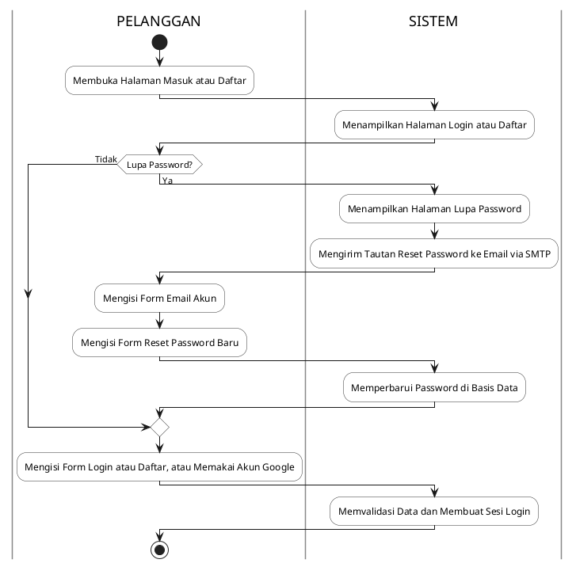

# Activity Diagram Autentikasi Pelanggan

Dokumen perancangan *Activity Diagram* untuk proses autentikasi (Login, Registrasi, dan Lupa Password) dengan pemisahan jalur tanggung jawab (*swimlane*) antara **Pelanggan** dan **Sistem**, mengacu pada **Gambar 3. 9 Activity Diagram Autentikasi Pelanggan**.

---

## 1. Visualisasi Diagram (Mermaid)

```mermaid
flowchart TD
    %% Swimlane Pelanggan
    subgraph PELANGGAN["PELANGGAN"]
        startNode(( ))
        act_open["Membuka Halaman Masuk atau Daftar"]
        dec_forgot{"Lupa Password?"}
        act_email["Mengisi Form Email Akun"]
        act_newpass["Mengisi Form Reset Password Baru"]
        merge_bar["▬▬▬▬▬▬▬▬▬▬▬▬▬▬▬▬▬▬▬▬"]
        act_fill_login["Mengisi Form Login atau Daftar, atau Memakai Akun Google"]
        endNode((( )))
    end

    %% Swimlane Sistem
    subgraph SISTEM["SISTEM"]
        act_show_login["Menampilkan Halaman Login atau Daftar"]
        act_show_forgot["Menampilkan Halaman Lupa Password"]
        act_send_smtp["Mengirim Tautan Reset Password ke Email via SMTP"]
        act_db_update["Memperbarui Password di Basis Data"]
        act_validate["Memvalidasi Data dan Membuat Sesi Login"]
    end

    %% Alur Aktivitas (Flow Transitions)
    startNode --> act_open
    act_open --> act_show_login
    act_show_login --> dec_forgot

    %% Cabang Lupa Password: Ya
    dec_forgot -- "Ya" --> act_show_forgot
    act_show_forgot --> act_send_smtp
    act_send_smtp --> act_email
    act_email --> act_newpass
    act_newpass --> act_db_update
    act_db_update --> merge_bar

    %% Cabang Lupa Password: Tidak
    dec_forgot -- "Tidak" --> merge_bar

    %% Penggabungan (Join / Merge) menuju Form Login
    merge_bar --> act_fill_login
    act_fill_login --> act_validate
    act_validate --> endNode

    %% Styling Komponen UML
    style startNode fill:#000000,stroke:#000000,stroke-width:2px
    style endNode fill:#ffffff,stroke:#000000,stroke-width:3px
    style merge_bar fill:#000000,color:#000000,stroke:#000000,stroke-width:2px
    style dec_forgot fill:#ffffff,stroke:#333333,stroke-width:1.5px
    
    style act_open fill:#ffffff,stroke:#333333,stroke-width:1.5px
    style act_show_login fill:#ffffff,stroke:#333333,stroke-width:1.5px
    style act_show_forgot fill:#ffffff,stroke:#333333,stroke-width:1.5px
    style act_send_smtp fill:#ffffff,stroke:#333333,stroke-width:1.5px
    style act_email fill:#ffffff,stroke:#333333,stroke-width:1.5px
    style act_newpass fill:#ffffff,stroke:#333333,stroke-width:1.5px
    style act_db_update fill:#ffffff,stroke:#333333,stroke-width:1.5px
    style act_fill_login fill:#ffffff,stroke:#333333,stroke-width:1.5px
    style act_validate fill:#ffffff,stroke:#333333,stroke-width:1.5px

    style PELANGGAN fill:#fafafa,stroke:#888888,stroke-width:1.5px
    style SISTEM fill:#fafafa,stroke:#888888,stroke-width:1.5px
```

<b>Gambar 3. 9 Activity Diagram Autentikasi Pelanggan</b>

---

## 2. Deskripsi Alur Aktivitas (*Use Case Scenario*)

| No | Aktor / Partisi | Aksi / Aktivitas | Keterangan |
|:---|:---|:---|:---|
| 1 | **Pelanggan** | *Initial Node* (Titik Mulai) | Memulai interaksi dengan aplikasi. |
| 2 | **Pelanggan** | Membuka Halaman Masuk atau Daftar | Pengguna mengakses URL autentikasi aplikasi. |
| 3 | **Sistem** | Menampilkan Halaman Login atau Daftar | Sistem memuat antarmuka formulir kredensial dan opsi login SSO Google. |
| 4 | **Pelanggan** | *Decision Node:* Lupa Password? | Pengecekan kondisi apakah pengguna mengingat kredensialnya atau tidak. |
| 5a | **Sistem** | Menampilkan Halaman Lupa Password | *(Kondisi: Ya)* Sistem mengarahkan ke form permintaan reset kata sandi. |
| 5b | **Sistem** | Mengirim Tautan Reset Password ke Email via SMTP | Sistem membuat token aman dan mengirim surel verifikasi ke alamat email pelanggan. |
| 5c | **Pelanggan** | Mengisi Form Email Akun | Pelanggan memasukkan email terdaftar untuk verifikasi akun. |
| 5d | **Pelanggan** | Mengisi Form Reset Password Baru | Pelanggan membuka tautan dari surel dan menginputkan password baru. |
| 5e | **Sistem** | Memperbarui Password di Basis Data | Sistem mengenkripsi kata sandi baru (bcrypt) dan menyimpannya ke tabel pengguna. |
| 6 | **Pelanggan** | *Synchronization Bar* (Penggabungan Alur) | Titik temu alur normal (ingat password) dan alur pemulihan (password baru berhasil dibuat). |
| 7 | **Pelanggan** | Mengisi Form Login atau Daftar, atau Memakai Akun Google | Pelanggan menginputkan kredensial masuk atau memilih Single Sign-On (OAuth Google). |
| 8 | **Sistem** | Memvalidasi Data dan Membuat Sesi Login | Sistem memverifikasi kredensial, mencatat audit log, dan menginisialisasi sesi autentikasi. |
| 9 | **Pelanggan** | *Activity Final Node* (Selesai) | Proses autentikasi tuntas dan pengguna dialihkan ke halaman utama / dashboard. |

---

## 3. Format Alternatif (PlantUML)

Jika dokumen tugas akhir/laporan Anda menggunakan generator diagram PlantUML (misal pada VS Code atau integrasi Word):

