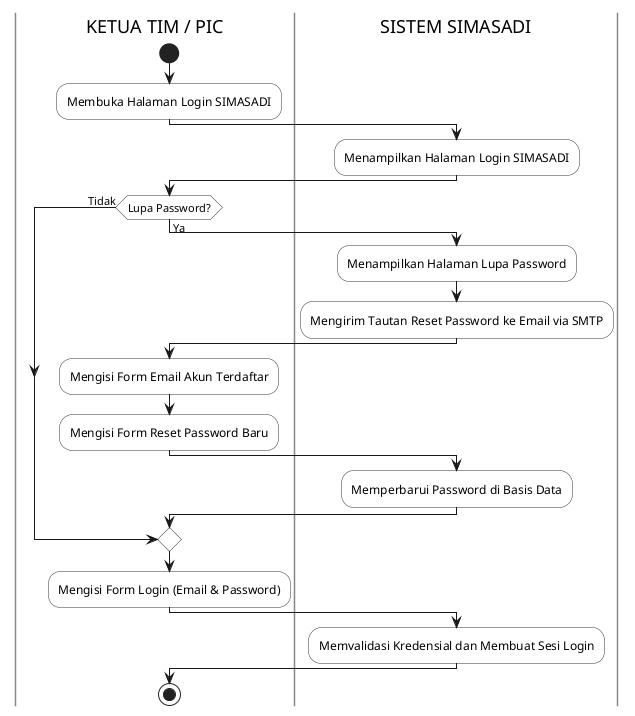

# Activity Diagram Autentikasi Pengguna (Ketua Tim & PIC)

Dokumen perancangan *Activity Diagram* untuk proses autentikasi (Login dan Pemulihan Kata Sandi) pada sistem SIMASADI dengan pemisahan jalur tanggung jawab (*swimlane*) antara aktor internal (**Ketua Tim / PIC**) dan **Sistem SIMASADI**, disesuaikan dengan arsitektur 2 peran nyata aplikasi.

---

## 1. Visualisasi Diagram (Mermaid)

```mermaid
flowchart TD
    %% Swimlane Ketua Tim & PIC
    subgraph PENGGUNA["KETUA TIM / PIC"]
        startNode(( ))
        act_open["Membuka Halaman Login SIMASADI"]
        dec_forgot{"Lupa Password?"}
        act_email["Mengisi Form Email Akun Terdaftar"]
        act_newpass["Mengisi Form Reset Password Baru"]
        merge_bar["▬▬▬▬▬▬▬▬▬▬▬▬▬▬▬▬▬▬▬▬"]
        act_fill_login["Mengisi Form Login (Email & Password)"]
        endNode((( )))
    end

    %% Swimlane Sistem SIMASADI
    subgraph SISTEM["SISTEM SIMASADI"]
        act_show_login["Menampilkan Halaman Login SIMASADI"]
        act_show_forgot["Menampilkan Halaman Lupa Password"]
        act_send_smtp["Mengirim Tautan Reset Password ke Email via SMTP"]
        act_db_update["Memperbarui Password di Basis Data"]
        act_validate["Memvalidasi Kredensial dan Membuat Sesi Login"]
    end

    %% Alur Aktivitas (Flow Transitions)
    startNode --> act_open
    act_open --> act_show_login
    act_show_login --> dec_forgot

    %% Cabang Lupa Password: Ya
    dec_forgot -- "Ya" --> act_show_forgot
    act_show_forgot --> act_send_smtp
    act_send_smtp --> act_email
    act_email --> act_newpass
    act_newpass --> act_db_update
    act_db_update --> merge_bar

    %% Cabang Lupa Password: Tidak
    dec_forgot -- "Tidak" --> merge_bar

    %% Penggabungan (Join / Merge) menuju Form Login
    merge_bar --> act_fill_login
    act_fill_login --> act_validate
    act_validate --> endNode

    %% Styling Komponen UML Sesuai Standar
    style startNode fill:#000000,stroke:#000000,stroke-width:2px
    style endNode fill:#ffffff,stroke:#000000,stroke-width:3px
    style merge_bar fill:#000000,color:#000000,stroke:#000000,stroke-width:2px
    style dec_forgot fill:#ffffff,stroke:#333333,stroke-width:1.5px
    
    style act_open fill:#ffffff,stroke:#333333,stroke-width:1.5px
    style act_show_login fill:#ffffff,stroke:#333333,stroke-width:1.5px
    style act_show_forgot fill:#ffffff,stroke:#333333,stroke-width:1.5px
    style act_send_smtp fill:#ffffff,stroke:#333333,stroke-width:1.5px
    style act_email fill:#ffffff,stroke:#333333,stroke-width:1.5px
    style act_newpass fill:#ffffff,stroke:#333333,stroke-width:1.5px
    style act_db_update fill:#ffffff,stroke:#333333,stroke-width:1.5px
    style act_fill_login fill:#ffffff,stroke:#333333,stroke-width:1.5px
    style act_validate fill:#ffffff,stroke:#333333,stroke-width:1.5px

    style PENGGUNA fill:#fafafa,stroke:#888888,stroke-width:1.5px
    style SISTEM fill:#fafafa,stroke:#888888,stroke-width:1.5px
```

<b>Gambar 3. 9 Activity Diagram Autentikasi Pengguna (Ketua Tim & PIC)</b>

---

## 2. Deskripsi Alur Aktivitas (*Use Case Scenario*)

| No | Aktor / Partisi | Aksi / Aktivitas | Keterangan Teknis |
|:---|:---|:---|:---|
| 1 | **Ketua Tim / PIC** | *Initial Node* (Titik Mulai) | Pengguna mengakses peramban web (*browser*). |
| 2 | **Ketua Tim / PIC** | Membuka Halaman Login SIMASADI | Pengguna mengakses URL rute `/login`. |
| 3 | **Sistem SIMASADI** | Menampilkan Halaman Login SIMASADI | Sistem merender tampilan formulir login (`auth.login`) beserta proteksi Google reCAPTCHA. |
| 4 | **Ketua Tim / PIC** | *Decision Node:* Lupa Password? | Pengecekan kondisi apakah pengguna mengingat kata sandinya atau memerlukan pemulihan. |
| 5a | **Sistem SIMASADI** | Menampilkan Halaman Lupa Password | *(Kondisi: Ya)* Sistem menampilkan formulir permohonan tautan reset kata sandi. |
| 5b | **Sistem SIMASADI** | Mengirim Tautan Reset Password ke Email via SMTP | Sistem men-generate token unik dan mengirimkan tautan reset ke alamat email resmi terdaftar melalui protokol SMTP. |
| 5c | **Ketua Tim / PIC** | Mengisi Form Email Akun Terdaftar | Pengguna memasukkan alamat email resmi untuk menerima token verifikasi. |
| 5d | **Ketua Tim / PIC** | Mengisi Form Reset Password Baru | Pengguna membuka tautan dari surel dan menginputkan password baru yang memenuhi syarat keamanan. |
| 5e | **Sistem SIMASADI** | Memperbarui Password di Basis Data | Sistem mengenkripsi kata sandi baru menggunakan algoritma `bcrypt` dan memperbarui tabel `users`. |
| 6 | **Ketua Tim / PIC** | *Synchronization Bar* (Penggabungan Alur) | Titik temu (*join bar*) antara alur langsung (ingat kata sandi) dan alur setelah kata sandi berhasil diperbarui. |
| 7 | **Ketua Tim / PIC** | Mengisi Form Login (Email & Password) | Pengguna menginputkan alamat surel dan kata sandi pada form login utama. |
| 8 | **Sistem SIMASADI** | Memvalidasi Kredensial dan Membuat Sesi Login | Sistem memverifikasi kredensial via `Auth::attempt()`, meregenerasi token sesi untuk keamanan anti-fixation, dan memuat peran pengguna (`admin` atau `pic`). |
| 9 | **Ketua Tim / PIC** | *Activity Final Node* (Selesai) | Sesi autentikasi aktif dan pengguna dialihkan ke halaman utama Dasbor SIMASADI (`/dashboard`). |

---

## 3. Format Alternatif (PlantUML)

Jika dokumen laporan/tugas akhir Anda menggunakan generator PlantUML:

